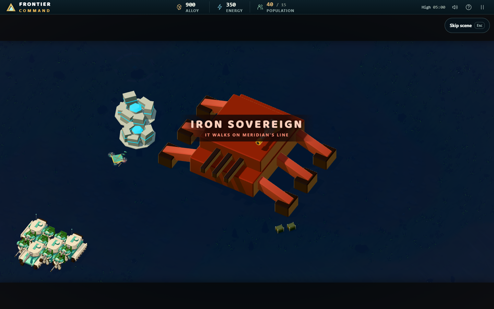
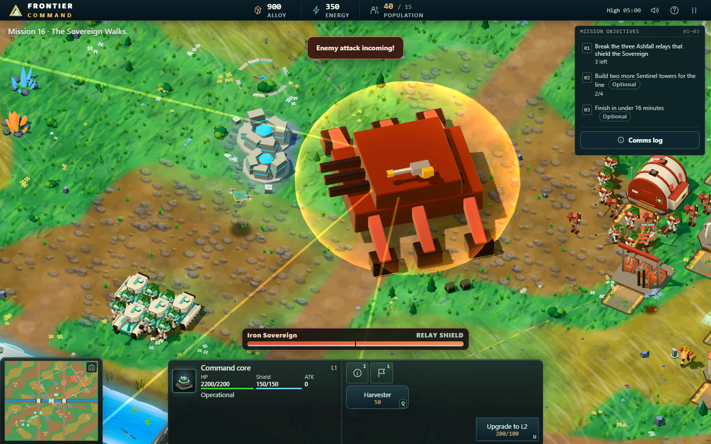
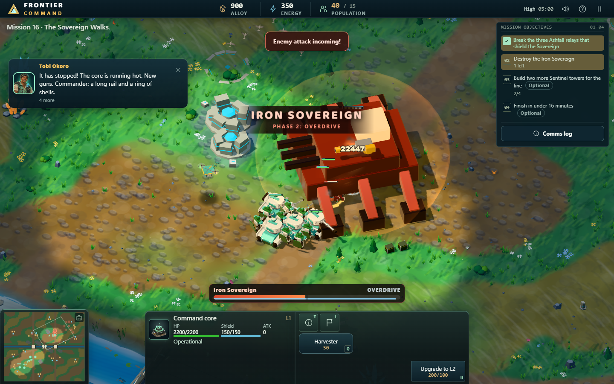
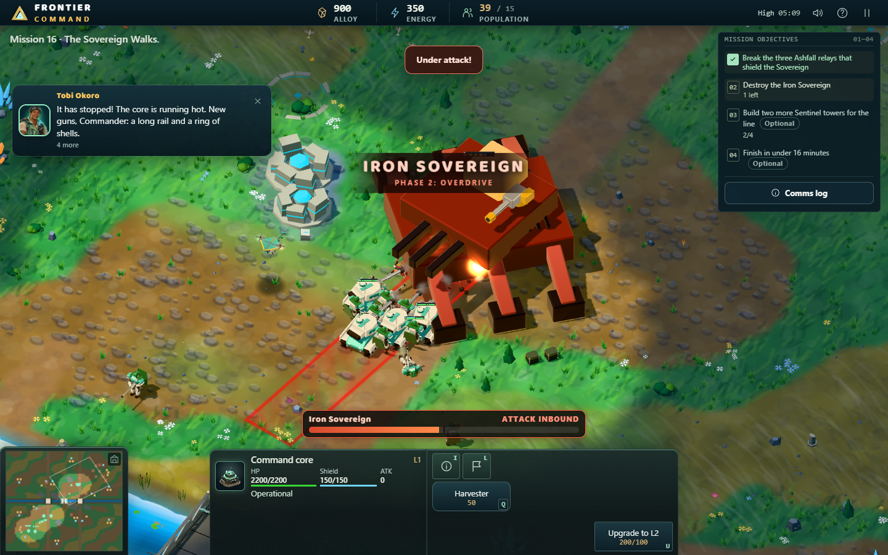
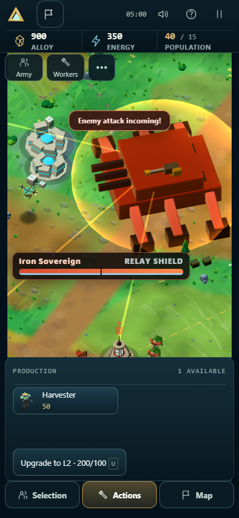
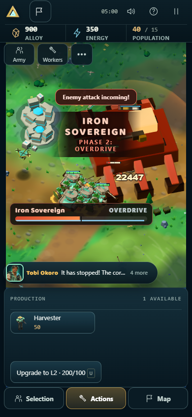
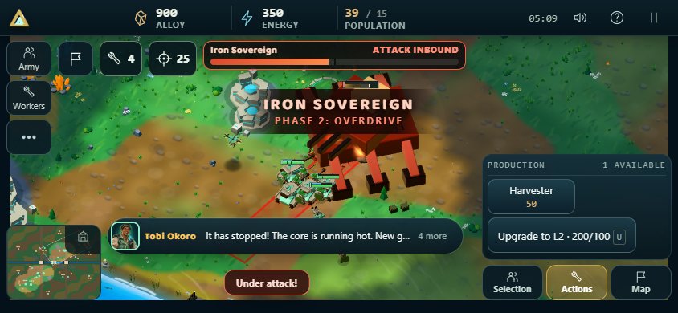

# R3-H: Boss phase 2 and "The Sovereign Walks"

Branch `r3/h-sovereign`, base `r3-wave-1m`, worktree `3d_astra-r3-h`, port 4233, 2026-11-21.

## What was built

| Part | Where |
|---|---|
| Boss engine III: `phases` (new attacks from a health stage, after a surge), `ward` (relays that shield), `march` (a field boss that walks on the enemy core). Optional data; the Iron Vanguard and the Iron Sovereign use none of it. | `src/sim/bosses.js` |
| New boss entry `iron-sovereign-2` and unit `ironsovereign2` (appended) | `src/balance.json`, `src/visual-style.json` |
| Relay shield (bubble + tethers, 2 draws, made on first use), phase-2 surge blast and shake, the core running hot in phase 2 | `src/boss-view.js` |
| Bar states RELAY SHIELD and OVERDRIVE; "Phase 2: overdrive" name card | `src/boss-ui.js`, `src/boss-presence-view.js` |
| The optional Act 3 mission and its entrance scene | new `src/story/sovereign-mission.js`; one import and one entry in `src/story/missions.js` |
| Model `ironsovereign2.glb` (the Sovereign's port under its own root name) | `tools/boss-parts/ironsovereign2.json`, `public/models/` (manifest entry appended, "pending owner review (round 3)") |
| Strings | `src/locales/story-vi.json` (31 story strings), `src/locales/vi.json` (6 UI strings) |
| Tests | `tests/sovereign-walks.test.js` (6), `tests/golden-r3h.test.js` (4), browser suite `tests/sovereign-walks.mjs` (`npm run test:sovereign-walks`, CI matrix `r3-h`), render scenario `boss-sovereign2-eco` |
| Docs | `docs/aaa/BOSSES.md` and `docs/MISSIONS.md` (new sections), `docs/CHANGELOG.md` |

### The fun moment

The Sovereign walks out of the north and you watch amber tethers run from three relays into its shield: your shells
spark off it. You break the relays one by one while your two forward towers hold it at the line (it stops to stomp
them). The shield drops, the bar turns from RELAY SHIELD to ARMORED, and you can finally hurt it. At half health it
plants itself, the core blazes, the ground shakes, "IRON SOVEREIGN / PHASE 2: OVERDRIVE", Okoro shouts about new
guns, the music rises, and a 24 m red rail is drawn across your army. Same rule as ever: step out of the red and
keep firing.

### Owner rules

- **Not harder.** Optional mission, Ashfall AI on `rules.ai: "home"` (never attacks on its own), one 5-unit probe
  and one 6-unit escort by script, two forward towers and ten units at the start, no time limit. The objective bot
  wins all three difficulties with gold and its Command core is never touched (minimum HQ health 2200 of 2200).
- **Spectacle, not a damage spike.** Phase-2 attacks keep every boss rule (walk-out warning, at most 30% of a
  Ranger's 120 on Veteran, one big attack every 10 to 15 s): rail sweep 28 (Veteran 30.8), barrage 27 (29.7), the
  same ceiling as the Sovereign's own spread. The surge is 4 s of standing still (no damage); the drops are 2 drones.
- **Low micro, one ability per unit, no bunkers or barricades.** Nothing new to click: relays are ordinary targets,
  auto-evade works for the new zones, the exposed core is automatic.

## Acceptance numbers

### `check:missions --only m11d` (`--jobs 3`, one difficulty at a time, final data)

| Difficulty | Passive | Generic | Objective bot | Lost | Medal |
|---|---|---|---|---|---|
| Story | running at 215 s (target: not beaten before 210) | (not run on Story) | **victory 410 s** | 0 | gold |
| Standard | running at 215 s | running at 485 s (target 480) | **victory 531 s** (window 420 to 1200) | 15 | gold |
| Veteran | running at 155 s | (not run on Veteran) | **victory 547 s** | 20 | gold |

`--spread` (Standard, Story and Veteran) gives the same lines: the army is gathered before anything is open, so
the march size does not matter here. The generic bot played to the 21-minute cap with `--full` is never beaten
(it ignores the objectives; the Sovereign cannot take a defended camp on its own).

How the objective bot's fight goes (`.tmp` probe, same build):

| Difficulty | Sovereign wakes | Bot's army then | Relays down | Phase 2 | Sovereign down | Fight after the shield | HQ lowest |
|---|---|---|---|---|---|---|---|
| Story | 300 s | 47 | 370 s | 388 s | 410 s | 40 s | 2200 / 2200 |
| Standard | 300 s | 45 | 484 s | 503 s | 530 s | 46 s | 2200 / 2200 |
| Veteran | 300 s | 45 | 511 s | 521 s | 546 s | 35 s | 2200 / 2200 |

The bot fields a much larger army here than in the other missions (no AI pressure), so its fight is short. A
player with about 25 units deals roughly half the damage: about 1.5 to 2 minutes for the Sovereign after the
relays, the Iron Vanguard's 2-minute window. Medals: gold 10:00, silver 14:00 (bot time rounded up, silver about
1.4 times).

Tuning steps (all on this branch): relays in the setup and the Sovereign at 2:30 let the bot win at 287 s (too
early for the 420 s window); the relays now wake with the Sovereign at 5:00, it has 44,000 HP (26,000 melted in
50 s under a 30-unit army) and its break share is 2.5% (1.65% broke every attack). A marching boss whose road was
searched at its own width found none into a camp packed with buildings: the road now falls back to an ordinary
unit's, and a blocked point is skipped after 3 s.

### Screenshots (built game, port 4233)

| | |
|---|---|
| Entrance scene (Okoro's Kite sees the gate)  | Phase 1: RELAY SHIELD, bubble and three tethers  |
| Surge: OVERDRIVE, "Phase 2: overdrive" card  | Phase 2: the rail sweep marked (ATTACK INBOUND)  |
| Phone portrait, phase 1  | Phone portrait, surge  |
| Phone landscape, phase 2  | |

(The "22447" in the surge shots is the test's own damage: it sets the boss to 49% health to reach the surge.)

### Render budget (RTX 4080, Eco, median)

| Scenario | Draws / limit | Triangles |
|---|---|---|
| battle-eco | 107 / 120 | 284k |
| boss-battle-eco | 116 / 120 | 286k |
| boss-sovereign-eco | 113 / 120 | 286k |
| **boss-sovereign2-eco** (new: ironsovereign2 + two relays) | **120 / 125** | 288k |

The relay shield adds 2 draws while a shielded boss is on screen (a bubble and one instanced draw for every tether)
and none otherwise; no buffer uploads beyond the tether matrices.

### Tests

| Check | Result |
|---|---|
| `npm test` | **1037 tests: 1009 pass, 28 skipped, 0 fail** (base 1027: +6 `sovereign-walks.test.js`, +4 `golden-r3h.test.js`, one of them long) |
| `npm run test:golden-full` | **91/91** (87 existing pins identical, 4 new) |
| `tests/sovereign-walks.mjs` (3 viewports) | PASS |
| `tests/boss.mjs`, `tests/sovereign.mjs`, `tests/showtime.mjs` (boss bar, presence, title cards) | PASS |
| `tests/render-budget.mjs` (the four rows above) | within limits |

### Pins

- Moved: none. `d071360b`, the 14 mission checksums, `golden-w1e` (the Iron Sovereign) and every other
  `golden-*` pin are identical.
- New: `golden-r3h` — sandbox (three relays) 30/90 s `426f2994` / `4c64b853`; phase 2 20/60 s `51a52825` /
  `152f0327`; mission with no orders 120/330 s `43b0f276` / `20e8572d`; 600 s (GOLDEN_FULL) `3610cd29`.

### Baselines

`npm run baselines:diff -- --full` against the recorded set (`docs/aaa/results/round2/baseline/`): **chronicles,
defence and bench-classic identical**; the five mission tables differ, as they already do on `r3-wave-1m` (left
failing on purpose for R3-I by the Wave 1b integrator, see `wave-1.md`). To isolate this branch's effect, the five
mission tables were recorded from the base tree (`r3-wave-1m`, extracted to `.tmp`) with
`baseline-diff --record --dir` and this branch compared with them (`--dir`, `--jobs 3`, 600 s cap):

| Table | Rows | Every row up to m11c | m11d rows (new) | m12 rows |
|---|---|---|---|---|
| missions-story | 32 -> 34 | identical | passive running; objective victory 410 s gold | identical, one position later |
| missions-standard | 48 -> 51 | identical | passive, generic running; objective victory 531 s gold | identical, one position later |
| missions-veteran | 32 -> 34 | identical | passive running; objective victory 547 s gold | identical, one position later |
| missions-standard-mercy | 48 -> 51 | identical | as Standard (victory 531 s gold) | identical, one position later |
| missions-standard-firm | 48 -> 51 | identical | as Standard (victory 531 s gold) | identical, one position later |

The tool compares by position, so it prints the m12 rows as "changed into m11d" plus "added m12" rows; the added
rows carry m12's base values (for example Standard objective defeat 914 s, the pre-existing R3-I item). Declared
change: three m11d rows inserted per Standard table (two on Story and Veteran), nothing else. The integrator
re-records the mission tables after R3-I. Checked directly: this branch's m12 Standard rows (check:missions --json --only m12) are byte-identical to the base tree's.

## Seam requests

1. **R3-G, `src/story/mission-intros.js`** (title card row), after the m11c row:
   ```js
     "m11d-the-sovereign-walks": { kicker: "ACT III", day: "DAY 54" },
   ```
   Then remove the `PENDING` exemption in `tests/keystone-roads.test.js` (title-card test; it switches itself off
   once the row exists, so the line may also simply stay).
2. **R3-G, `src/story/openings.js`** (new table): an opening for `m11d-the-sovereign-walks` on the Expanse that
   frames the north road the Sovereign walks: start high over the ford looking north, about `{ x: -2, z: 6 }`, and
   end on the player's line at the region `line` `{ x: -22, z: 18 }` (the two forward towers), 5 s. It differs
   from m11/m12 (same map) by framing the ford and the line, not the conduits or the Keystone.
3. **R3-G, `src/story/campaign-map.js`**: no change needed; `MAP_NODES` places m11d in Act 3 by itself (six nodes,
   15.6% apart, checked by `keystone-roads.test.js`). It holds no decision, so no choice marker.
4. **Integrator, `src/story/scenes.js`** (optional): the entrance scene `sovereign-walks` is registered from
   `src/story/sovereign-mission.js` with `Object.assign(SCENES, SOVEREIGN_SCENES)`, so `scenes.js` stayed
   untouched. It may move into `SCENES` as a plain entry (then drop the `Object.assign` and import).
5. **R3-J (portraits and Sovereign port):** `ironsovereign2` is a new unit type without a portrait cell. If J's
   "every unit type has a portrait cell" test lands, either render a cell for it (it is the same model) or let it
   share `ironsovereign`'s. If J re-ports the Iron Sovereign in the round-3 palette, re-port this one with the same
   palette: `node tools/port-boss-model.mjs <Tank_game_3D>/public/models/boss-walker.glb public/models/ironsovereign2.glb --parts tools/boss-parts/ironsovereign2.json`
   (and set its palette in that parts file to J's).
6. **R3-U (Wave 3, audio), optional:** a sound for the new event `bossSurge` in `audio-logic.js` `soundFor` (today the
   surge is heard through `bossStage`'s heavy blast, which fires on the same tick).

## Test changes for the integrator

Count and order assertions that a new mission must update (each change is one line, with a comment):

| File | Change |
|---|---|
| `tests/missions-data.test.js` | `m11d-the-sovereign-walks` in the id list, between m11c and m12 |
| `tests/story-scenes.test.js` | `MISSIONS.length` 16 to 17; m11d in the list of missions that play a scene |
| `tests/wings.test.js` | `MISSIONS.length` 16 to 17 |
| `tests/keystone-roads.test.js` | m12 now follows m11d (m11c + 2); Act 3 has six nodes; the title-card `PENDING` exemption (seam 1) |

R3-I owns the other missions in `missions.js`; if I adds missions too, these counts add up.

## Story lines (English and Vietnamese, for the owner)

| Who | When | English | Vietnamese |
|---|---|---|---|
| Okoro | briefing | Commander, I have read the Keystone's traffic. Hale has refitted the Iron Sovereign, and this time it walks. | Thưa Chỉ huy, tôi đã đọc tín hiệu từ Then Chốt. Hale đã tân trang Quân Vương Thép, và lần này nó biết bước đi. |
| Okoro | briefing | Three Ashfall relays feed it a shield. While one of them stands, our shells barely scratch it. | Ba trạm Ashfall cấp khiên cho nó. Chừng nào còn một trạm đứng vững, đạn của ta chỉ làm nó trầy xước. |
| Okoro | briefing | Break the relays, then break the machine. And when it is hurt, watch it. Builder machines change when they are hurt. | Phá các trạm, rồi phá cỗ máy. Và khi nó bị thương, hãy để ý. Máy của người Kiến Tạo thay đổi khi bị thương. |
| Vale | 0:05 | Two towers on the line and a squad behind them, Commander. Build up while it is still far away. | Hai tháp pháo trên tuyến và một tiểu đội phía sau, thưa Chỉ huy. Hãy củng cố khi nó còn ở xa. |
| Okoro | 1:30 | Ashfall crews are standing at three old relay posts. Whatever they wait for, it is coming from the north. | Lính Ashfall đang đứng ở ba trạm cũ. Dù chúng chờ thứ gì, thứ đó đang đến từ phía bắc. |
| Okoro | 4:40 | My Kite is over the north road. Whatever comes down it, we will see it first. | Diều trinh sát của tôi đang bay trên con đường phía bắc. Thứ gì đi xuống đó, ta sẽ thấy trước. |
| Okoro | scene | There it is, coming down from the Keystone. Hale gave the Sovereign legs that walk, not just legs that stand. | Nó đây rồi, đang từ Then Chốt đi xuống. Hale đã cho Quân Vương đôi chân biết đi, chứ không chỉ để đứng. |
| Hale | scene | Meridian. My Sovereign walks to your camp, and my relays carry its shield. Nothing you own can stop it. | Meridian. Quân Vương của ta đang tiến về trại các người, và các trạm của ta mang khiên cho nó. Không gì của các người cản được nó. |
| Okoro | 5:10 | The relays woke with it. One sits south of the river, by the old pump: that one is the easy one. | Các trạm thức dậy cùng nó. Một trạm nằm ở bờ nam, cạnh trạm bơm cũ: trạm đó là dễ nhất. |
| Okoro | a relay at half | That relay is failing. When the last one goes dark, its shield goes with it. | Trạm đó sắp sập. Khi trạm cuối cùng tắt, khiên của nó cũng mất theo. |
| Okoro | relays down | Last relay down! Its shield is gone. Everything on the Sovereign now, Commander. | Trạm cuối đã đổ! Khiên của nó đã mất. Dồn hết vào Quân Vương ngay, thưa Chỉ huy. |
| Hale | relays down | Then it walks without a shield. It has walked through worse than you. | Vậy thì nó đi mà không cần khiên. Nó đã đi qua những thứ tệ hơn các người. |
| Okoro | phase 2 | It has stopped! The core is running hot. New guns, Commander: a long rail and a ring of shells. | Nó dừng lại rồi! Lõi đang nóng rực. Súng mới, thưa Chỉ huy: một đường ray dài và một vòng đạn pháo. |
| Vale | phase 2 | Same rule as before. Watch the red, step out, and keep shooting. | Vẫn quy tắc cũ. Nhìn vùng đỏ, bước ra, và tiếp tục bắn. |
| Hale | phase 2 | Half a Sovereign is still a Sovereign, Commander. | Một nửa Quân Vương vẫn là Quân Vương, Chỉ huy ạ. |
| Okoro | it falls | It is down, and it will not walk again. I am sorry, old machine. | Nó đổ rồi, và sẽ không bước đi nữa. Xin lỗi nhé, cỗ máy già. |
| Hale | it falls | My last walker. Very well, Commander. The Keystone will decide the rest. | Cỗ máy biết đi cuối cùng của ta. Được thôi, Chỉ huy. Then Chốt sẽ quyết định phần còn lại. |
| Okoro | debrief (win) | The Sovereign fell short of our line. Its core is still warm, and I would like to keep it. | Quân Vương đã gục trước tuyến của ta. Lõi của nó vẫn còn ấm, và tôi muốn giữ lại nó. |
| Vale | debrief (win) | Hale has nothing that big left to send. One road left, Commander, and it ends at the Keystone. | Hale không còn thứ gì lớn như thế để gửi đến nữa. Chỉ còn một con đường, thưa Chỉ huy, và nó dẫn tới Then Chốt. |
| Vale | debrief (loss) | It walked through the camp. We pull back to the river and try again before it turns. | Nó đã đi xuyên qua trại. Ta lui về sông và thử lại trước khi nó quay đầu. |

## Open questions for the owner

- The walking Sovereign reuses the Iron Sovereign's model and palette; the relay shield and the hot core tell it
  apart. A darker "refitted" palette is one parts-file change once R3-J's palette lands.
- Okoro's line "Builder machines change when they are hurt" sets up phase 2 as a Builder trait; later bosses could
  reuse `phases` the same way (the Iron Vanguard could get a phase 2 as a new entry, as the plan allows).
